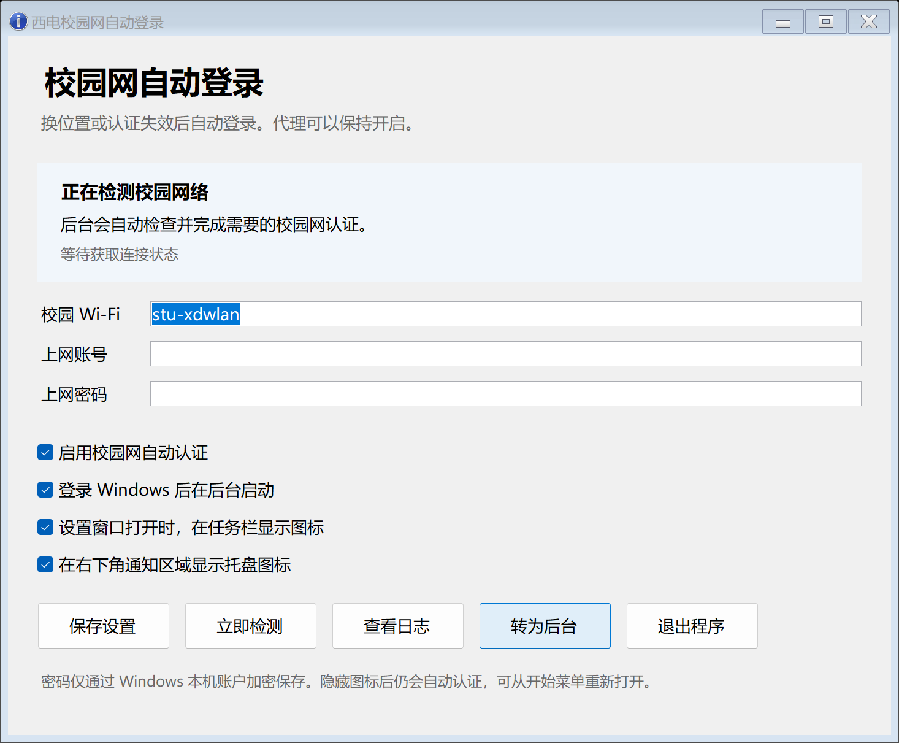

# 西电校园网自动登录

Windows 校园网自动认证小工具，适配西安电子科技大学 `w.xidian.edu.cn` 的深澜 SRun 认证。连接校园 Wi-Fi 后检测认证状态，在换位置或认证失效时自动登录。Clash Party / Mihomo TUN 可以保持开启。



## 使用

需要 Windows 10/11 和 **PowerShell 7.4 或更新版本（.NET 8+）**。

1. 下载项目或 `git clone`，在 PowerShell 7 中运行安装脚本，例如：

   ```powershell
   ./Install.ps1 -Destination D:\XidianCampusLogin
   ```

2. 在本地设置窗口填写学校网页所使用的上网账号、密码，点击“保存设置”。密码不需要写入源码。
3. 默认 SSID 为 `stu-xdwlan`。多个校园 SSID 用英文逗号分隔；只添加可信的校园 Wi-Fi。
4. 点击“转为后台”或关闭窗口即可隐藏设置窗口。程序继续自动认证，登录 Windows 后自动在后台启动。

安装会创建桌面和开始菜单的“西电校园网自动登录”入口。即使完全隐藏图标，点击入口也能唤回已经运行的窗口，不会产生重复的认证进程。

`Launch.ps1` 会查找标准 PowerShell 7 安装以及现有 Codex 附带的运行环境。没有可用运行环境时会给出提示；可从 [PowerShell 官方安装文档](https://learn.microsoft.com/en-us/powershell/scripting/install/installing-powershell-on-windows) 安装 PowerShell 7。

## 界面与后台运行

- 根据显示 DPI 和字体自动排版，支持缩放及窗口大小变化。文字自动换行，窄窗口时按钮换行，空间不足时可滚动。
- **在任务栏显示图标**：控制设置窗口打开时的任务栏入口。
- **显示托盘图标**：控制右下角通知区域图标。关闭该选项仍会进行后台认证，可从开始菜单重新打开设置。
- **登录 Windows 后在后台启动**：当前用户登录后自动启动常驻后台进程，启动时隐藏设置窗口。
- **退出程序**：停止窗口及后台认证。右上角关闭按钮只隐藏窗口。
- 后台监测进程意外结束后，应用会尝试恢复它。应用和监测进程都有互斥锁，防止重复运行。

## 认证与代理直连

每 15 秒检查一次。物理网卡 IP、网关、DNS 或接入点变化时重新检测；保持同一 IP 但认证失效也能检测到。已认证时不重复提交密码。

DNS 和 HTTPS TCP 套接字使用当前校园网物理网卡，并设置 Windows `IP_UNICAST_IF`。HTTP 客户端关闭系统代理，DNS 直接查询校园网卡下发的服务器。程序不改动全局代理、Clash 配置、hosts 或系统路由表。

只向 `https://w.xidian.edu.cn` 提交账号信息，保留 HTTPS 证书校验。程序读取学校页面的当前 `acid` 与 IP，使用学校页面对应的 challenge、HMAC-MD5、SRBX1 和 SHA-1 协议。登录后再次核对学校在线状态，并进行校园网卡直连外网检测。

认证失败后按 60、120、240、480、900 秒退避。明确的账号、余额或在线设备数错误会暂停自动提交；保存设置或点击“立即检测”可以手动重试。

程序负责连接校园 Wi-Fi 后的网页认证，Wi-Fi 的连接和漫游由 Windows 管理。浏览器自行打开的认证页面仍按浏览器及代理软件原配置访问。

## 本地数据

程序目录下的 `data/` 保存本机设置、状态和日志：

| 文件 | 用途 |
| --- | --- |
| `settings.json` | 账号、Windows 用户加密的密码、SSID 与图标选项 |
| `status.json` | 校园网检测状态 |
| `ui-state.json` | 窗口和图标状态，用于检查后台运行 |
| `activity.log` | 状态变化日志，不记录账号、密码或认证请求地址 |

安装时会限制数据目录权限。密码通过当前 Windows 用户的 DPAPI 加密，本用户权限下的其他程序仍可能解密。`data/` 已加入 `.gitignore`，不要手动将配置或日志提交到公开仓库。

从旧版更新时，安装脚本会在目标目录没有配置的情况下迁移 `%LOCALAPPDATA%\XidianCampusLogin` 中已有的配置和日志；迁移后密码仍由原 Windows 用户使用。不要把一个用户的加密密码作为共享配置分发。

## 检测与测试

独立只读诊断（先从设置窗口退出后台程序）：

```powershell
./Monitor.ps1 -Diagnose
```

运行回归检查：

```powershell
./tests/Test.ps1
# 无交互桌面的环境
./tests/Test.ps1 -SkipUi
```

检查包括协议测试向量、跳转地址白名单、旧版设置兼容、图标设置保存、Windows 密码加密和布局尺寸。测试向量来自与学校当前 JavaScript 编码结果的对照，均使用虚构账号和密码；测试不会提交校园网登录。

当前已验证在 Clash Party 的 TUN 开启时直接访问校园 DNS、HTTPS 认证页、认证状态接口与外网检测；未主动注销校园网或强制切换区域。实际跨区域自动认证需在对应网络场景验证。如果学校页面或认证协议发生变化，需要更新适配。

## 停用

取消“登录 Windows 后在后台启动”并保存，再点击“退出程序”。之后可移除程序目录及桌面、开始菜单快捷方式。删除 `data/` 会同时删除本地账号配置。

Windows 接口参考：[IPPROTO_IP socket options](https://learn.microsoft.com/en-us/windows/win32/winsock/ipproto-ip-socket-options)。
